<div align="center">

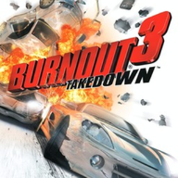

# b3x

**Burnout 3: Takedown, natively on Android**

The original Xbox (NTSC-U) release of Burnout 3: Takedown, lifted instruction
by instruction from the XBE to C and compiled for arm64 phones. No emulator:
the game's own code runs on the phone's CPU, its NV2A GPU commands are drawn
with Vulkan, and its APU is mixed into Android audio.

[](#-devices)
[](#-how-it-works)
[](#-quick-start)
[](#-devices)
[](CHANGELOG.md)
[](LICENSE)

<p align="center">
  <a href="#-screenshots">Screenshots</a> •
  <a href="#-quick-start">Quick start</a> •
  <a href="#-features">Features</a> •
  <a href="#-controls">Controls</a> •
  <a href="#-devices">Devices</a> •
  <a href="#%EF%B8%8F-building">Building</a> •
  <a href="#-credits">Credits</a>
</p>

</div>

---

> [!IMPORTANT]
> **No game data is included, and none ever will be.** The APK carries only
> the recompiled engine. You need your own copy of the Xbox disc (NTSC-U,
> title ID `0x4541005B`), extracted to a folder on the phone.

## 📸 Screenshots

Infinix X6815D (Dimensity 920 class, Mali-G68 MC4), Android 13, 2460x1080,
internal resolution 2x, the Drive touch layout.

<table>
  <tr>
    <td width="50%">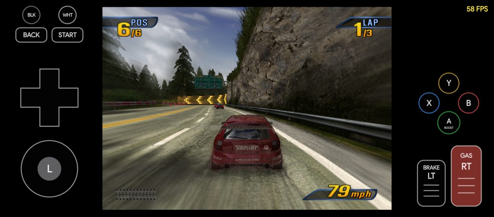<br><sub>Race: Alpine, 58 fps, GAS held on the touch pedal</sub></td>
    <td width="50%">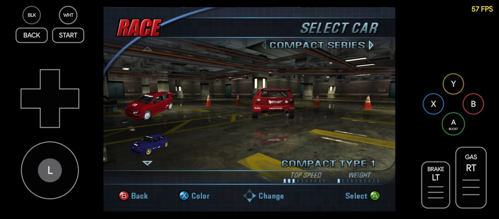<br><sub>Car select: the lit garage, reflections</sub></td>
  </tr>
  <tr>
    <td>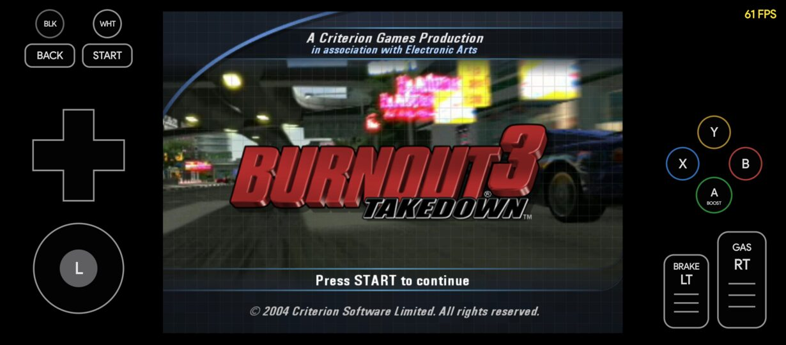<br><sub>Title screen</sub></td>
    <td>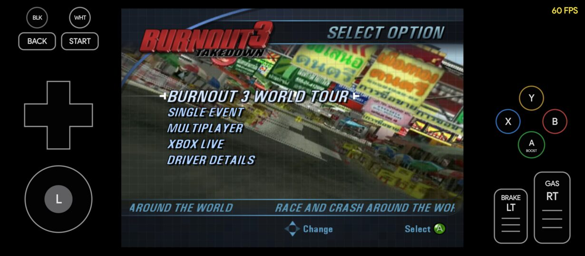<br><sub>Main menu, profile loaded</sub></td>
  </tr>
  <tr>
    <td>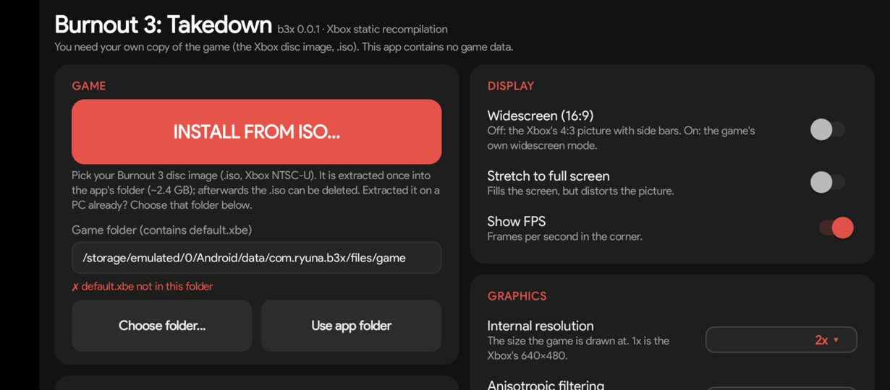<br><sub>First run: INSTALL FROM ISO… or choose an extracted folder</sub></td>
    <td>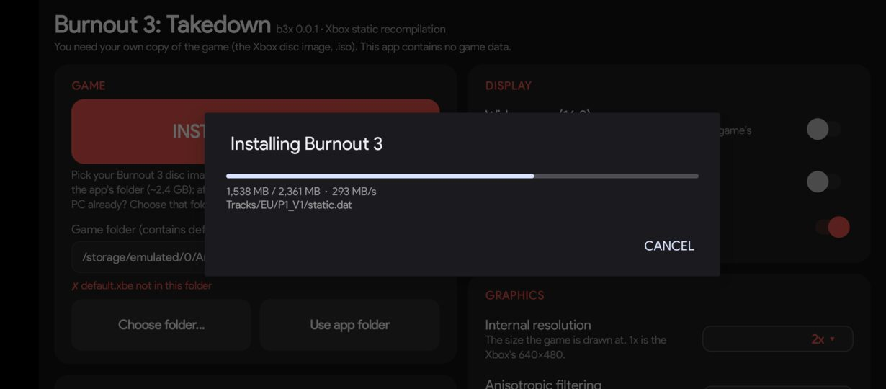<br><sub>Extracting the .iso on the phone (~290 MB/s)</sub></td>
  </tr>
  <tr>
    <td>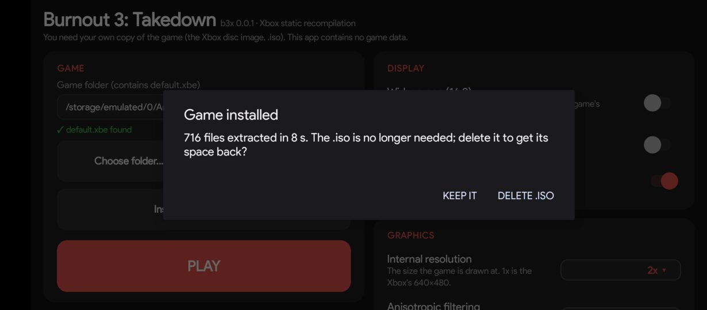<br><sub>716 files in 8 s; keep or delete the .iso</sub></td>
    <td>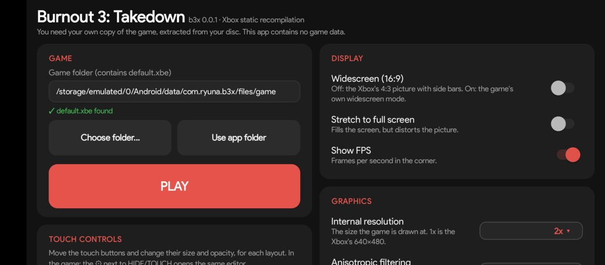<br><sub>Installed: PLAY, the folder can still be changed</sub></td>
  </tr>
  <tr>
    <td>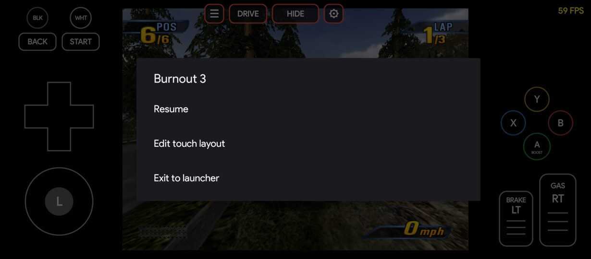<br><sub>☰ in-game menu: resume, edit layout, exit</sub></td>
    <td></td>
  </tr>
</table>

## 🚀 Quick start

1. **Install the APK** and open **b3x**.
2. **Give it the game**, one of two ways:
   - **From the disc image** — copy your `.iso` (Burnout 3: Takedown, Xbox
     NTSC-U, ~2.4 GB) to the phone, e.g. `Download/`, tap **INSTALL FROM
     ISO…** and pick it. The launcher checks it, extracts it once into the
     app's folder (8 s on the Infinix) and offers to delete the `.iso`.
   - **Already extracted on a PC** — copy the folder (the one with
     `default.xbe`) to the phone and point the launcher at it: **Choose
     folder…**, type the path, or put it in
     `Android/data/com.ryuna.b3x/files/game/` and tap **Use app folder**.
3. **PLAY.** Next time the launcher goes straight to PLAY.

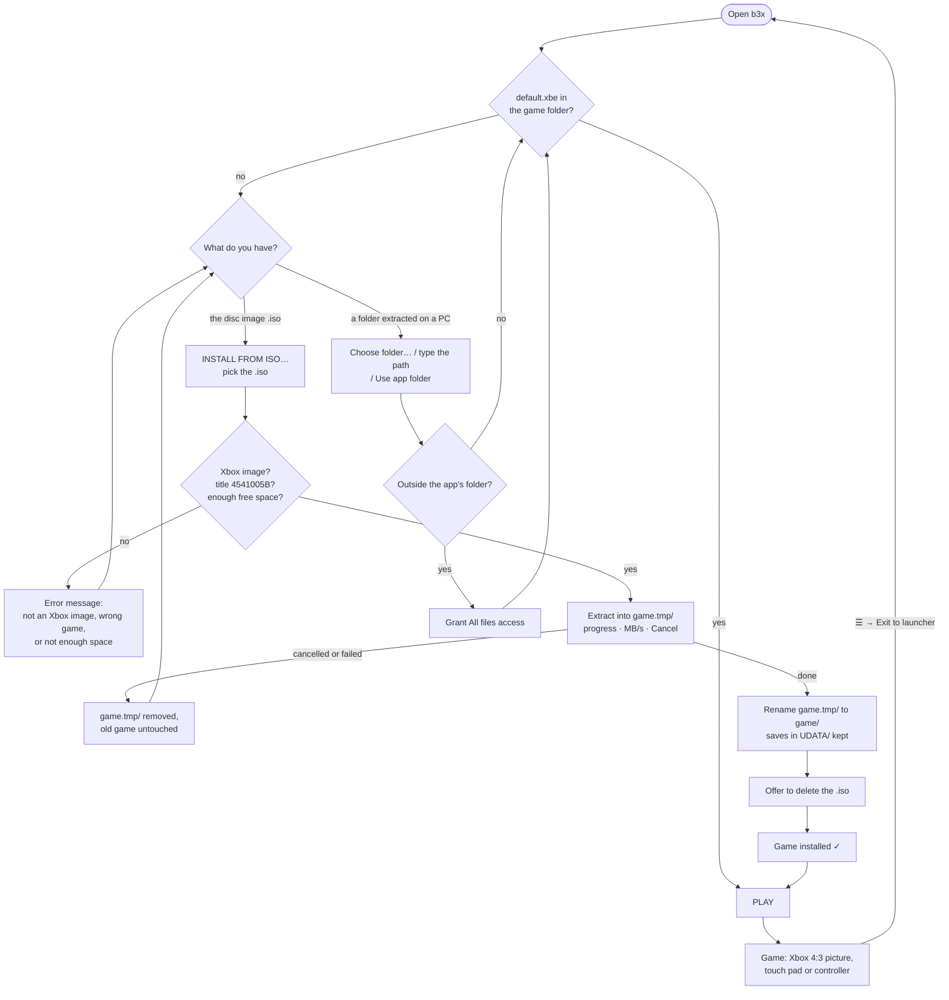

The two ways can be mixed: **Install again from ISO…** stays on the Game
card after a first install, and the folder can be changed at any time.
Saves live in the game folder's `UDATA/`; a reinstall from ISO keeps them.

## ✨ Features

- **Native, not emulated** — about 24,000 lifted functions compiled with clang
  `-O2`; a menu or race uses about one big core.
- **Vulkan renderer for any phone** — Vulkan 1.3 path for current drivers,
  automatic Vulkan 1.1 path (render passes, descriptor sets, baked pipeline
  state) for older ones such as Mali r32p1.
- **Picture as on the Xbox** — 4:3 pillarboxed, never stretched (16:9 and
  stretch are options), up to 2x internal resolution, anisotropic filtering,
  FXAA.
- **Real-time races below 60 fps** — the game's fixed-step clock follows wall
  time, so a dropped frame never turns into slow motion.
- **Two touch layouts**
  - *Drive* — steering stick (or ◀ ▶ arrows, or tilt the phone), GAS and
    BRAKE pedals, BOOST over the pedals with X/Y/B around it, D-pad, all in
    the black side bars so the picture stays clear.
  - *Full* — the complete original Xbox controller: both sticks with L3/R3,
    D-pad, A B X Y, Black, White, LT/RT, Back, Start.
- **Layout editor** — drag any control, size (one or all), opacity, reset;
  from the launcher or the ⚙ in the game, saved per layout.
- **Controllers** — any Android gamepad; per-button remapping, dead zone,
  invert Y; the touch pad hides while a pad is in use. Rumble goes to the pad,
  or to the phone's vibrator without one.
- **In-game menu (☰)** — resume, edit the touch layout, or exit to the
  launcher.
- **Install from ISO** — pick the disc image once; it is checked and
  extracted in the launcher, no PC tools needed.
- **Debug log** — `b3x_log.txt` with fps and guest thread snapshots, for
  hang and crash reports.

## 🎮 Controls

Burnout 3's own controls (from the Xbox manual):

| Xbox | Race | Menus |
|---|---|---|
| RT | Accelerate | |
| LT | Brake / reverse | |
| Left stick, D-pad | Steer | Highlight / change |
| A | Boost; hold while crashing for Impact Time | Select |
| B | Crashbreaker (Crash mode) | Back |
| X | Look back | Car colour |
| Y | Change view | |
| Start | Pause | |

Black, White, Back, the right stick and L3/R3 have no function in this game;
the Full layout still has them. The original Xbox controller has no bumpers
(LB/RB): Black and White sit where they would be.

**Overlay buttons** (top centre, fade after 4 s, a tap brings them back):
☰ menu · **DRIVE/FULL** switch layout · **HIDE/TOUCH** hide the pad · ⚙
edit layout.

## 📱 Devices

| Device | SoC / GPU | Driver | Result |
|---|---|---|---|
| **Infinix X6815D** (Android 13) | MediaTek MT6877 (Dimensity 920 class), Mali-G68 MC4 | Mali r32p1, Vulkan 1.1 | ✅ menus 60 fps, races 55-60 fps at 2x, Vulkan 1.1 path |
| **POCO M3** (Android 15) | Qualcomm Snapdragon 662, Adreno 610 | Adreno 512.658, Vulkan 1.1 | ✅ menus 58-60 fps, races 36-44 fps at 1x, Vulkan 1.1 path |
| Snapdragon 7s Gen 2 phones | Adreno 710 | Vulkan 1.3 | ⏳ not tested yet |
| Linux desktop (dev host) | any Vulkan GPU | RADV, lavapipe | ✅ |

Requirements: Android 11 (API 30) or newer, arm64-v8a, Vulkan 1.1, about
400 MB of RAM for the game. Device notes and bring-up logs:
[docs/research/android-devices.md](docs/research/android-devices.md).

## 🧩 How it works

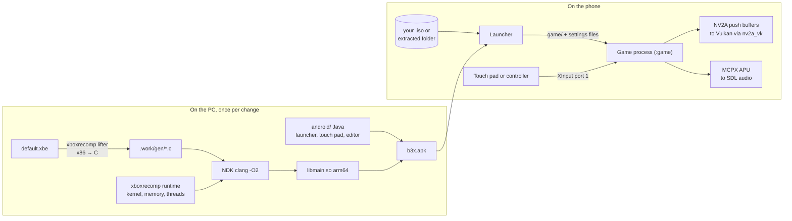

- The guest's 4 GB address space is reserved once; the XBE, the 64 MB of RAM
  and the GPU apertures map into it at their Xbox addresses.
- The game's D3D8 talks to an emulated NV2A: push buffers are parsed on the
  CPU and turned into Vulkan draws with shaders made from the register
  combiner and vertex program state.
- Fixes found during the Android bring-up (Mali swapchain of 9 images, a
  race in the GPU fence wait, surface loss on resume, ...) are in
  [docs/research/android-devices.md](docs/research/android-devices.md) and
  [CLAUDE.md](CLAUDE.md).

## 🛠️ Building

Development happens on Linux; the same code runs there as a desktop program,
which is where most debugging is done.

<details open>
<summary><b>1. Extract the disc and lift the XBE to C</b></summary>

```sh
python3 -m venv .work/venv && .work/venv/bin/pip install -r tools/requirements.txt
# Your own image goes in roms/ (git-ignored)
(cd xboxrecomp && ../.work/venv/bin/python -m tools.xiso unpack "../roms/<disc>.iso" -o ../roms/game)
tools/regen.sh          # roms/game/default.xbe -> .work/gen/
```

</details>

<details open>
<summary><b>2a. Android</b> (NDK r28c, SDK 36, a phone with USB debugging)</summary>

```sh
export ANDROID_HOME=~/Android/Sdk
scripts/android/b3x.sh deps         # SDL2 + glslang for arm64 (once)
scripts/android/b3x.sh native apk   # libmain.so (~10 min at -j3), then the APK
scripts/android/b3x.sh install run log
scripts/android/b3x.sh push-game    # dev only: copy roms/game to the phone
```

`b3x.sh` commands: `deps native apk install push-game env run log stop all`;
`-s <serial>` picks a device.

</details>

<details>
<summary><b>2b. Linux</b> (SDL2 + Vulkan)</summary>

```sh
cmake -S . -B build/linux-vk -G Ninja -DNFSU2_VULKAN=ON -DNFSU2_GEN_DIR=$PWD/.work/gen
cmake --build build/linux-vk -j3
NFSU2_GAME_DIR=$PWD/roms/game build/linux-vk/b3_recomp
```

</details>

<details>
<summary><b>3. Release</b> (signed APK → GitHub Release)</summary>

Releases are built on the maintainer's machine: `libmain.so` comes from code
lifted out of `default.xbe`, which never leaves `roms/`.

```sh
scripts/android/keystore.sh      # once: release key + android/keystore.properties (git-ignored)
gh auth login                    # once: GitHub CLI

scripts/release.sh --current     # first release: 1.0.0 as in android/version.properties
scripts/release.sh patch         # 1.0.1 -> 1.0.2
scripts/release.sh minor         # 1.0.2 -> 1.1.0
scripts/release.sh major         # 1.1.0 -> 2.0.0
scripts/release.sh 1.4.0         # an explicit version
```

Each run: version into `android/version.properties` (versionCode =
major·10000 + minor·100 + patch), CHANGELOG `[Unreleased]` becomes the
version's section, native + signed release APK, `dist/b3x-<v>.apk` and its
SHA-256, commit `Release <v>`, tag `v<v>`, push, GitHub Release with the APK.
`--no-native` reuses libmain.so, `--no-publish` stops before pushing,
`--draft` makes a draft release. The `release` workflow then checks the tag,
the changelog, the checksum and the APK's signature and version.

Step by step, what stays private and key backup: [docs/RELEASING.md](docs/RELEASING.md).

</details>

## ⚙️ Configuration

The launcher writes everything it sets; anything else goes in `b3x_env.txt`
in `Android/data/com.ryuna.b3x/files/`, one `KEY=VALUE` per line (on Linux,
environment variables).

<details>
<summary><b>Launcher settings → files</b></summary>

| Launcher | Written as |
|---|---|
| Internal resolution, anisotropic, FXAA | `b3x_options.txt` (the game's own Gameplay rows) |
| Widescreen, stretch, volume, Vulkan 1.1, frame lock, debug log | `b3x_env.txt` (`RECOMP_WIDESCREEN`, `RECOMP_STRETCH`, `RECOMP_AUDIO_VOLUME`, `RECOMP_VK_LEGACY`, `B3_FRAME_LOCK`, ...) |
| Controller mapping | `b3x_padmap.txt` (`RECOMP_PAD_MAP`) |
| Touch layouts | app preferences (`b3x_touch`) |

</details>

<details>
<summary><b>Graphics</b></summary>

| Variable | Meaning |
|---|---|
| `RECOMP_VK_LEGACY=1` | Force the Vulkan 1.1 path. |
| `RECOMP_WIDESCREEN` | 1 = the game's 16:9 mode (Android default 0, 4:3). |
| `RECOMP_STRETCH=1` | Fill the screen (distorts). |
| `RECOMP_GL_SCALE` | Render resolution multiple, until the Gameplay row changes it. |
| `RECOMP_VK_ANISO` | Anisotropic filtering cap, 1..16. |
| `RECOMP_VK_FXAA` | FXAA on/off. |
| `RECOMP_PROG_CACHE` | Shader/pipeline cache file, `=0` off. |
| `RECOMP_FPS_LOG=1` | Presented frames per 10 s. |

</details>

<details>
<summary><b>Game, audio, debugging</b></summary>

| Variable | Meaning |
|---|---|
| `NFSU2_GAME_DIR` | Extracted disc (Android default `<app files>/game`). |
| `B3_FRAME_LOCK=1` | One simulation step per frame, as on the Xbox. |
| `RECOMP_AUDIO_VOLUME` | Master volume 0..100. |
| `RECOMP_NO_MIRRORS=1` | No RAM mirrors (Android default). |
| `RECOMP_QUIET=0` | Periodic kernel/GPU summaries. |
| `RECOMP_FRAME_TRACE=<flag file>` | One line per draw of the next frame. |
| `RECOMP_APU_VOICES=1` | Every APU voice every 5 s. |

</details>

## 📂 Project layout

```
burnout3-sw/
├── android/app/src/main/java/com/ryuna/b3x/
│   ├── LauncherActivity.java     # launcher: folder, settings, PLAY
│   ├── B3xActivity.java          # the game (SDLActivity), ☰ menu, rumble
│   ├── TouchControllerView.java  # Drive/Full touch pad + its editor
│   ├── EditorActivity.java       # layout editor from the launcher
│   ├── GamepadMapActivity.java   # controller remapping
│   ├── Settings.java, UiKit.java # prefs → env files; launcher widgets
├── src/
│   ├── android_main.c            # SDL_main on Android, env, JNI
│   ├── main.c                    # boot and runtime defaults
│   └── recomp_manual.c           # hand-written overrides of lifted functions
├── .github/workflows/release.yml # checks each release tag and its APK
├── xboxrecomp/                   # the toolkit, vendored with this port's changes
│   └── src/{kernel,nv2a_vk,input,audio,platform}/
├── scripts/release.sh            # version bump, signed APK, GitHub Release
├── scripts/android/              # deps.sh, b3x.sh, keystore.sh, test-runtime.sh
├── tools/regen.sh                # XBE → .work/gen/*.c (never committed)
├── docs/                         # research notes, screenshots
└── roms/                         # your disc and its extraction (git-ignored)
```

## 🙏 Credits

- [sp00nznet](https://github.com/sp00nznet): the Burnout 3 recompilation and
  the [xboxrecomp](https://github.com/sp00nznet/xboxrecomp) toolkit (MIT).
- [antoxa2584x](https://github.com/antoxa2584x/burnout3-sw): the Switch/Linux
  port with the GPU renderers this Android port is built from.
- [victorgbd/NFSMW-Recompiled-Mobile](https://github.com/victorgbd/NFSMW-Recompiled-Mobile):
  the model for the touch layouts, the editor and the launcher.
- [SDL2](https://libsdl.org), [glslang](https://github.com/KhronosGroup/glslang).

Burnout 3: Takedown is © Electronic Arts / Criterion Games. This project is
not affiliated with them and contains none of their data.

## 📜 License

[MIT](LICENSE), as the projects it is built on.
